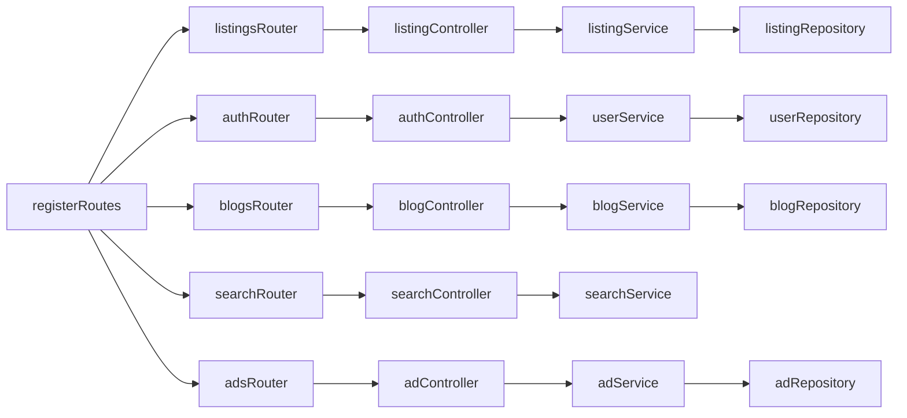

# Backend feature graph

Before editing a feature, call `codegraph_explore` with `projectPath` `D:\MarketPlace\MarketPlace-Back-End-Node-Parisma` and the prompt seed for that feature.

Edges below come from Codegraph (`codegraph_explore` on `registerRoutes`, `codegraph callers`, and `codegraph query`). `opencode/gpt-5.5` returned insufficient funds. `opencode/nemotron-3-ultra-free` queried the index and did not write this file.

`registerRoutes` in `src/routes/index.js` mounts every router below on `/api`.

## Health

- Route: `GET /api/health` inside `registerRoutes`
- Symbol: `runtimeSummary` in `src/lib/runtime.js`
- Prompt seed: Explore registerRoutes runtimeSummary before editing the health check.

## Public

- Route: `/api/public` → `src/routes/public.js`
- Call path: `public.js` → `contactService` (`src/services/contactService.js`)
- Prompt seed: Explore registerRoutes publicRouter contactService before editing public contact reads.

## Listings and images

- Route: `/api/listings` → `src/routes/listings.js` and `src/routes/listingImages.js`
- Call path: `listings.js`, `listingImages.js`, and `src/routes/users.js` → `listingController` → `listingService` → `listingRepository`
- Also: `listingService` → `renewRepository`
- Also: `listingController` (`forApproval`, `emitAllForApproval`) → `emitToApprovals`; `update` and `patch` → `emitToUser`
- Prompt seed: Explore listingController listingService listingRepository emitToApprovals before editing listing create or approval.

## Categories

- Route: `/api/categories` → `src/routes/categories.js`
- Call path: `categoryController` → `categoryService` → `categoryRepository`
- Also: `categoryController` calls `categoryRepository` directly
- Prompt seed: Explore categoryController categoryService categoryRepository before editing categories.

## Representatives

- Route: `/api/representatives` → `src/routes/representatives.js`
- Call path: `representativeController` → `representativeService` → `representativeRepository`
- Also: `authController` → `representativeService`
- `forwardingService` calls `representativeRepository` and has no callers in the graph
- Prompt seed: Explore representativeController representativeService authController before editing representatives.

## Auth

- Route: `/api/auth` → `src/routes/auth.js` → `authController`
- Call path: `authController` → `userService` → `userRepository`
- Also: `authController` → `representativeService`
- The graph has no `authService` symbol
- Prompt seed: Explore authController userService representativeService before editing login or registration.

## Users

- Route: `/api/users` → `src/routes/users.js` → `userController`
- `users.js` also calls `listingController`
- `userService` callers are `authController` only. A `userController` → `userService` edge is not in the graph
- Prompt seed: Explore userController userService listingController before editing user profile or photo upload.

## Roles

- Route: `/api/roles` → `src/routes/roles.js` → `roleController`
- No `roleService` symbol in the graph
- Prompt seed: Explore roleController before editing role assignment.

## Search

- Route: `/api/search` → `src/routes/search.js` → `searchController` → `searchService`
- `searchService.search` uses Prisma when Elasticsearch is disabled, and `getES` when it is enabled
- Prompt seed: Explore searchController searchService getES before editing search.

## Renew

- Route: `/api/renew` → `src/routes/renew.js` → `renewController` → `renewService` → `renewRepository`
- `renewService.redeemToken` → `emitToUser`
- Prompt seed: Explore renewController renewService redeemToken before editing listing renewal.

## Notifications

- Routes: `/api/notifications` and `/api/notification` → `src/routes/notifications.js` → `notificationController`
- `notificationController.send` → `emitToUser`
- No `notificationService` symbol in the graph
- Prompt seed: Explore notificationController emitToUser before editing notifications.

## Feedbacks

- Route: `/api/feedbacks` → `src/routes/listingFeedbacks.js` → `listingFeedbackController`
- No feedback service constant in the graph. `src/workers/feedbackWorker.js` `start` calls `startQueueWorker`
- Prompt seed: Explore listingFeedbackController feedbackWorker before editing listing feedback.

## Ads

- Route: `/api/ads` → `src/routes/ads.js` → `adController` → `adService` → `adRepository`
- Prompt seed: Explore adController adService adRepository before editing ads.

## Stories

- Route: `/api/stories` → `src/routes/stories.js` → `storyController` → `storyService` → `storyRepository`
- Prompt seed: Explore storyController storyService storyRepository before editing stories.

## Blogs

- Route: `/api/blogs` → `src/routes/blogs.js` → `blogController` → `blogService` → `blogRepository`
- `blogController` `create`, `approve`, and `reject` → `emitToUser`; `create` and `emitAllPendingBlogs` → `emitToApprovals`
- Prompt seed: Explore blogController blogService blogRepository emitToApprovals before editing blogs.

## Contacts

- Route: `/api/contacts` → `src/routes/contacts.js` → `contactController` → `contactService` → `contactRepository`
- `public.js` also calls `contactService`
- Prompt seed: Explore contactController contactService contactRepository before editing contacts.

## Admin

- Route: `/api/admin` → `src/routes/admin.js` → `adminController` → `reportService`
- Prompt seed: Explore adminController reportService before editing admin pending lists or reports.

## Workers and jobs

- `src/index.js` → `registerWorkers` (`src/workers/register.js`)
- Static callees of `registerWorkers` are only `logger`. Which worker `start` it loads is not in the graph
- `start` in these files calls `startQueueWorker` (`src/jobs/bullmq.js`): `moderationWorker.js`, `notificationWorker.js`, `searchWorker.js`, `renewalCleanupWorker.js`, `feedbackWorker.js`, `blogExpiryWorker.js`, `contentCleanupWorker.js`, `statusCleanupWorker.js`
- `cleanupService` callers: `src/jobs/handlers.js` and `src/routes/maintenance.js`
- Prompt seed: Explore registerWorkers startQueueWorker cleanupService before editing background jobs.

## Socket.io

- `emitToUser` and `emitToApprovals` live in `src/websocket/socket.js`
- `emitToUser` callers include `notificationController`, `cleanupService.notifyListingDeletion`, `jobs/handlers.js` `notifyUser`, `blogController` create/approve/reject, `renewService.redeemToken`, `listingController` update/patch, `notifications/dispatcher.js` `createNotification`
- `emitToApprovals` callers: `listingController` and `blogController`
- Prompt seed: Explore emitToUser emitToApprovals before editing realtime approval or notification events.

## Confirmed flow

## Unconfirmed

- `registerWorkers` does not statically call the worker `start` functions. Do not assume which workers boot from that function until Codegraph shows the edge.
- `src/routes/maintenance.js` calls `cleanupService`. `registerRoutes` does not mount that router.
- `forwardingService` has no callers. `registerRoutes` does not mount a forward router.
- No graph edge from `userController` to `userService`.
- No `authService`, `roleService`, `notificationService`, or `adminService` symbol.
